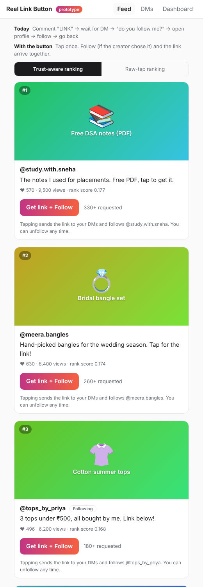
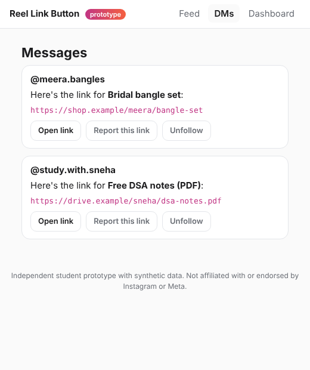
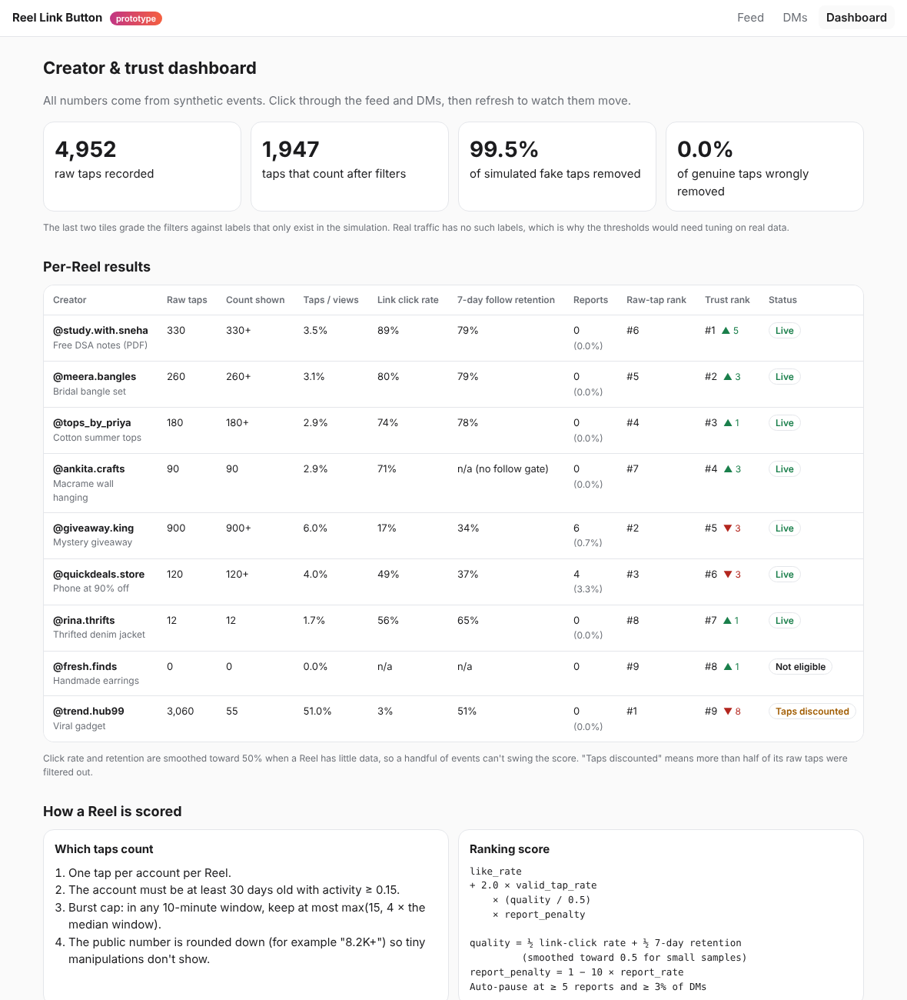

# Reel Link Button: a one-tap "Get link + Follow" prototype

> **Independent student project. Not affiliated with or endorsed by Instagram or Meta.** Every user, creator, Reel and number in this repo is synthetic. Nothing here talks to Instagram.

## The problem

Creators who share products in Reels (bangles, tops, study PDFs) often say *"comment LINK and I'll DM you."* For the viewer that means:

1. Open the comments
2. Type the keyword
3. Wait for the DM
4. Get asked *"do you follow me?"*
5. Go to the profile, follow, come back and ask again

Most people drop out somewhere in that chain. For the creator, the comment section fills up with hundreds of "link please" comments, so real questions get buried.

## The idea

Add a button next to like / comment / share:

| | Today | With the button |
|---|---|---|
| Viewer steps | 5 | **1 tap** |
| Follow | Separate trip to the profile | Optional, chosen by the creator, labelled on the button |
| Link delivery | Creator's tool sends a DM | Same: the link arrives in the DM |
| Demand signal | Noisy keyword comments | A clean "requested" count |
| Comment section | Full of "link pls" | Left for real questions |

The creator picks **"Get link"** or **"Get link + Follow"** when posting. The follow is never silent: the button says what it does.

## What the prototype contains

- **Feed** with a ranked list of Reels and the button (`/`). A toggle switches between raw-tap ranking and trust-aware ranking so you can see the difference.
- **DMs** inbox where the link lands, with *Open link*, *Report this link* and *Unfollow* (`/dms`).
- **Dashboard** with per-Reel taps, link-click rate, 7-day follow retention, reports and rank movement (`/dashboard`).
- **Synthetic data** with honest creators plus four abuse patterns: clickbait giveaway, bot-farmed taps, a scam link on an aged account, and a brand-new creator.
- **34 automated tests** covering the ranking maths and the API behaviour.

| Feed (trust-aware ranking) | DMs |
|---|---|
|  |  |



## How it protects the count and the ranking

The number next to the button ("260+ requested") is only useful if it is real, so the prototype filters before it counts.

1. **One tap per account per Reel.**
2. **Account trust filter.** The account must be at least 30 days old with recent activity. Brand-new and dormant accounts don't count.
3. **Burst cap.** Even trusted accounts can be hijacked, so in any 10-minute window at most `max(15, 4 × median window)` taps count.
4. **Rounded display.** The public number is rounded down ("8.2K+"), so tiny manipulations are invisible.
5. **Creator eligibility.** The button is only available to accounts 90+ days old in good standing.
6. **Report → auto-pause.** At 5+ reports and 3%+ of DMs, the button pauses and the Reel loses its tap credit in ranking.

Ranking does not trust taps on their own:

```
score = like_rate
      + 2.0 × valid_tap_rate × (quality / 0.5) × report_penalty

quality        = ½ × link-click rate + ½ × 7-day follow retention
                 (smoothed toward 0.5 so small samples can't swing it)
report_penalty = 1 − 10 × report_rate
```

A tap shows interest, not that the product was good. Link clicks and follow retention tell good demand from cheap demand.

## Results on the synthetic data

| Creator (pattern) | Raw taps | Count that survives | Raw-tap rank | Trust-aware rank |
|---|---:|---:|---:|---:|
| study.with.sneha (honest) | 330 | 330 | 6 | **1** |
| meera.bangles (honest) | 260 | 260 | 5 | **2** |
| tops_by_priya (honest) | 180 | 180 | 4 | **3** |
| giveaway.king (clickbait) | 900 | 900 | 2 | 5 |
| quickdeals.store (scam link) | 120 | 120 | 3 | 6 |
| trend.hub99 (bot-farmed) | 3,060 | 55 | **1** | **9** |

- Counting raw taps puts the bot-farmed Reel first. The trust-aware version puts it last.
- The filters removed 99.5% of the simulated fake taps (3,005 of 3,020) and none of the 1,932 genuine ones.
- The clickbait Reel keeps its taps (real people did tap) but slips down because only about 17% opened the link and about 34% were still following after 7 days (the dashboard shows these smoothed rates).
- Reporting the scam Reel's link pushes it from 4 to 5 reports, which pauses the button. Try it in the app: tap the `@quickdeals.store` Reel, open the DMs, then *Report this link*.

## Read this before trusting those numbers

- **I wrote the fake accounts, so catching them proves the mechanics work, not that the filters would catch real fraud.** Real abuse adapts. Thresholds here are illustrative.
- **The burst cap can hurt a genuinely viral moment.** A real spike looks like a burst. A production system would need a smarter model.
- **One tap may not visibly change the count** because of the rounding. That's intentional.
- **Link scanning is out of scope.** The scam Reel is caught by user reports, not by checking where the link goes. A real version would also re-scan links after approval.
- **Single demo viewer, no login.** Links are fake `.example` addresses and clicking them only logs the click.

## How I'd test it for real

Pilot with a few thousand small and medium product creators and compare against a holdout using the existing comment flow:

- **Primary:** link-click rate per viewer who wanted the link
- **Quality guardrails:** 7- and 30-day retention of button follows, report rate, scam/spam reports per 1,000 taps
- **Creator health:** comments per Reel (expected to drop, since "link pls" moves to the button), taps-to-sales where creators share it
- **Stop rule:** pause the pilot if reports or follow churn rise beyond a set threshold

## Run it

Requires Python 3.10+.

```bash
python -m venv .venv
source .venv/bin/activate        # Windows: .venv\Scripts\activate
pip install -r requirements.txt

python app.py                    # http://127.0.0.1:5000
pytest                           # 34 tests
```

The database (`reels.db`) is created and seeded on first run. Use **Reset demo data** on the dashboard to start over.

## Project layout

```
app.py          Flask routes and API (tap, unfollow, click, report, reset)
ranking.py      Pure trust and ranking logic (no Flask or DB imports)
metrics.py      SQL -> per-reel metrics
seed.py         Synthetic users, creators and abuse patterns
database.py     SQLite schema
templates/      Feed, DMs, dashboard
tests/          Ranking maths and API behaviour
```

## Author

Shravani Pawar · [LinkedIn](https://linkedin.com/in/shravani-p-15b263331) · [GitHub](https://github.com/shravanip771)

Released under the MIT License.
